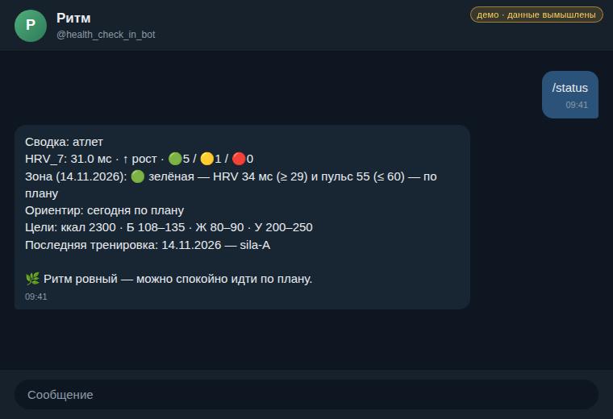
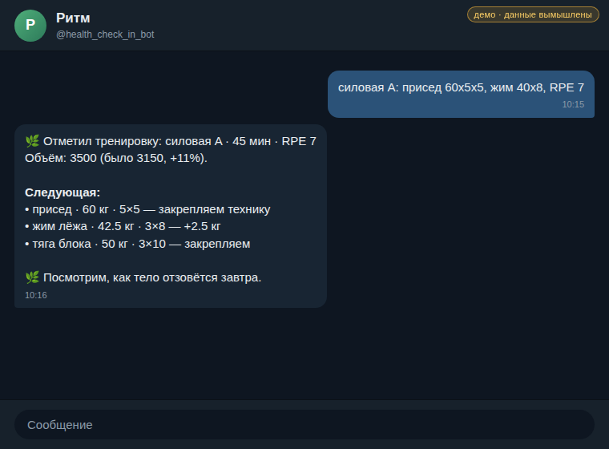
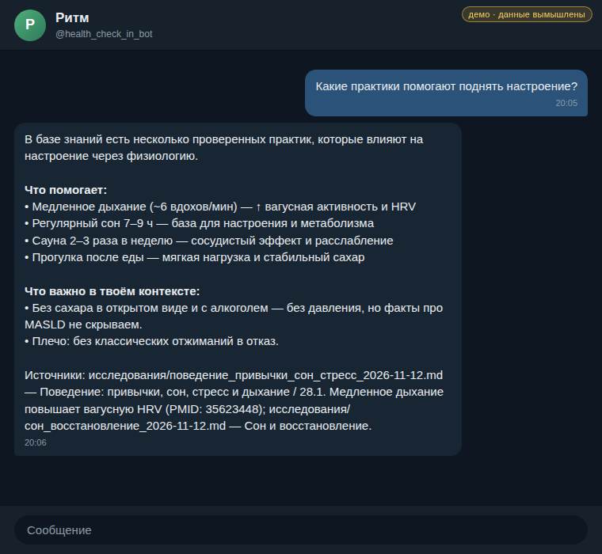

# healthbot — Telegram-бот «Ритм» для тренировок и ЗОЖ

Pet-проект: персональный бот-тренер, который принимает чек-ины, тренировки,
питание и замеры, считает зоны готовности по HRV/пульсу, ведёт историю в
Markdown, ищет по локальной базе знаний и отвечает с опорой на источники.

**Статус:** рабочий личный бот. Не медицинское изделие и не публичный
multi-user-сервис: данные и chat_id не публикуются, LLM выбирается владельцем.
В репозитории нет реальных данных пользователей и токенов — только код и
синтетические демо-материалы.

Реализовано: intake текста и скриншотов, зоны/HRV_7, дневник-отчёт тренировки,
питание и средние за 7 дней, недельная сводка и воскресный разбор, формы,
настройки с русскими алиасами, `/ask` по базе знаний, Telegram-формат,
Prometheus-метрики, webhook/polling и деплой на VPS.

Отчёт о работе для агентов: [`docs/результаты_работы.md`](docs/результаты_работы.md).
Спецификация и фича-доки: [`docs/features/`](docs/features/).

## Демо в Telegram

Скриншоты **синтетические**: тексты и цифры вымышлены, реальная переписка не
публикуется. Это актуальный формат ответов бота — Telegram HTML, списки,
эмодзи-индикаторы и тон «Ритма».

| Статус | Тренировка | /ask |
|---|---|---|
|  |  |  |

Ещё экраны и описание — [`docs/demo/README.md`](docs/demo/README.md).
Практики разработки и разбор ошибок — [`docs/development-practices.md`](docs/development-practices.md).

## Быстрый старт

Требования: Go **1.27.4** (`go.mod` пинит toolchain; на машине может стоять
1.26+ — Go сам скачает нужный toolchain), GNU Make.

```bash
cp .env.example .env      # BOT_TOKEN из BotFather, chat_id (allowlist) и BOT_PROXY_URL
make run                  # long polling, Ctrl+C — graceful shutdown
```

> **Прокси (из РФ):** прямой доступ к `api.telegram.org` заблокирован, поэтому
> `make run` требует `BOT_PROXY_URL` (например `http://127.0.0.1:12334`;
> поддерживаются `http`, `https`, `socks5`). Без прокси `make run` не подключится,
> хотя `make dry-run` пройдёт — он не ходит в сеть. Если прокси не нужен,
> оставь `BOT_PROXY_URL=` пустым (прямое подключение).

Проверить каркас без Telegram и без токена:

```bash
make dry-run              # конфиг + прогон /help через фейковый отправитель
make test                 # unit/integration-тесты (без сети)
make ask Q="Ответь: кто ты?"   # LLM-смоук без Telegram (Ollama/API из .env)
```

## Команды Makefile

| Цель | Что делает |
|---|---|
| `make run` | запустить бота (long polling, нужен `.env`) |
| `make dry-run` | самопроверка: конфиг + обработчик `/help`, без сети и токена |
| `make ask Q="…"` | вопрос активному LLM без Telegram (проверка модели и инструментов) |
| `make image IMG="…"` | распознать скриншот(ы) через vision без Telegram (пути через запятую) |
| `make checkin TEXT="…"` | распознать текстовый чек-ин без Telegram |
| `make test` | `go test -race -count=1 ./...` |
| `make vet` | `go vet ./...` |
| `make lint` | golangci-lint **v2.15.0** по `.golangci.yml` |
| `make fmt` / `make fmt-check` | форматирование / проверка (gofmt+gofumpt+goimports) |
| `make cover` | покрытие тестами |
| `make check` | всё качество: fmt-check + vet + lint + test |
| `make build` | бинарь в `bin/healthbot` |
| `make vuln` | `govulncheck ./...` |
| `make install-tools` | поставить зафиксированный golangci-lint в `.bin/` |

`make check` — обязательный минимум перед PR; `make e2e` — сквозной набор
команд/форм для релизной проверки. Те же проверки гоняются в CI
([`.github/workflows/ci.yml`](.github/workflows/ci.yml)).

## Диск и кэши

Go/линтер/браузерные кэши растут при каждом прогоне и сами не чистятся.
Периодически смотри `make doctor` и чисти `make clean-cache` (безопасно: только
производные артефакты репозитория, данные не трогает). Подробный регламент:
[`docs/operations/disk-and-caches.md`](docs/operations/disk-and-caches.md),
[`docs/operations/deploy-vps.md`](docs/operations/deploy-vps.md) — VPS, systemd,
self-signed webhook по IP, polling, метрики, 1 ГБ RAM.

## Структура

```
cmd/healthbot/main.go        запуск: флаги, signal-контекст, graceful shutdown
internal/app/                сборка приложения, long polling, self-check (--dry-run), LLM-смоук -ask
internal/config/             env + .env → Config, валидация, маскирование секретов
internal/logging/            slog JSON в logs/healthbot.log + stderr, формат [пакет:метод]
internal/router/             allowlist по chat_id, /help, свободный текст → LLM-чат
internal/llm/                провайдеры Ollama/OpenAI-совместимый + агент с инструментами
internal/tools/              инструменты для LLM (read_last_checkin)
internal/intake/             приём скриншотов (vision) и текстового чек-ина, нормализация
docs/                        отчёт о работе + docs/features/ (фич-спеки)
docs/features/               спеки фич (TDD/SDD), контекст для следующих агентов
```

Домен и обработчики не зависят от сети: `router` общается с Telegram через
интерфейс `Sender`, поэтому тестируется фейковым отправителем. На M1+ рядом
появятся `nlu/`, `analysis/`, `store/`, `kb/`, `llm/`, `settings/` (ТЗ §5).

## Логи (NFR-3)

- JSON в `logs/healthbot.log` (дублируется в stderr), `log/slog`.
- Формат сообщения: **`[пакет:метод] суть на русском`** — по префиксу за секунды
  находится пакет и метод-источник; детали — в attrs (`chat_id`, `update_id`,
  `proxy`), а не в тексте. Примеры:
  ```text
  [app:Run] запуск healthbot
  [app:Run] бот запущен на аккаунте @health_check_in_bot
  [app:runLongPolling] long polling запущен, ожидаю обновления
  [router:HandleUpdate] сообщение от постороннего chat_id проигнорировано
  [telego:api] ошибка Telegram API: ...
  ```
- При старте бот проверяет токен/прокси через `getMe` и пишет аккаунт (`@username`,
  id) — видно, под каким ботом запущен инстанс; при ошибке `getMe` завершается с
  понятным сообщением.
- Секреты (токен, ключи API) маскируются (`***`) во всех сообщениях и атрибутах
  логов, включая текст ошибок HTTP-клиента telego.

## Скриншоты других приложений

Скриншоты сна/готовности/тренировок из Zepp/Amazfit, Mi Fitness, Garmin, Apple
Health и др. разбираются двухфазно: сначала тип экрана, затем специализированный
промпт. Тренировка со скрина читается через OCR и разбирается кодом
(общее время, средняя ЧСС, калории, таблица упражнений); после сохранения —
тот же разбор и «следующая тренировка», что для текста; сон — длительность/баллы
и отдельно метрики (HRV, пульс покоя, SpO2, дыхание). Битые поля отбрасываются,
даты резолвятся кодом. Чек-ин и тренировка сохраняются в разные файлы по своим датам.

## История и масштабирование

Разобранная история кэшируется в памяти (`internal/store.Cache`): повторные
`/status`, `/week` и коуч-ответы не перечитывают все файлы (замер: 365 файлов —
22.8 мс → 10.4 мкс). LLM получает не сырые markdown и не всю историю, а
компактную сводку (последний чек-ин, HRV_7, зоны, последние тренировки,
≤1.5k символов). План Markdown-канон + производный SQLite-индекс, per-user lock
и мультипользовательность — [`docs/architecture/scaling-plan.md`](docs/architecture/scaling-plan.md).
SQLite read-model (`DATA_ROOT/.healthbot/history.db`) уже подключён: rebuild из
Markdown при старте, write-through после записей, fallback на Markdown при сбое.

## Форматирование сообщений

Все ответы в Telegram проходят `internal/telegramfmt`: Markdown → безопасный HTML
(`parse_mode=HTML`), таблицы превращаются в читаемые пункты, списки/жирный/код/
ссылки рендерятся нативно. HTML из модели/текста экранируется. Файлы отчётов и
база знаний остаются Markdown-каноном; конвертация — только для чата.

## Характер: «Ритм»

Бот говорит голосом «Ритма» — спокойного наблюдателя, который помогает слышать
тело. Не мотиватор и не «друг»: заземление вместо давления, факты без морали,
краткость, опора на данные. Зоны/планы/протоколы при этом остаются точными —
персонаж меняет подачу, а не анализ. Правила голоса и границы: `internal/persona`
+ FR-8 в ТЗ; детерминированные ответы (чек-ин, питание, intake, команды) следуют
той же лексике, а семантические 🟢/🟡/🔴/✅/⚠️/↑→↓ остаются индикаторами данных.

## Команды

- `/help`, `/start` — справка;
- `/settings` — цели/зоны читаемыми блоками; CLI-ключи (`kcal`, `weekly_review` и т.д.) — в заголовках; `/set` понимает русские алиасы (`Воскресный разбор`, `Время разбора`, `ккал`);
- `/set <ключ> <значение>` — изменить цель/порог (kcal, макро, hrv_base, rhr, margins…), `/set reset` — вернуть дефолты;
- `/status` — HRV_7 из файлов (среднее/направление/зоны), зона по последнему чек-ину, ориентир, цели, последняя тренировка (провайдеры — в `/settings`, не в статусе);
- `/training <текст>` — записать тренировку и получить **дневник-отчёт** (утро, разминка, таблица, кардио, статистика, анализ, прогрессия за 6 тренировок); если нет RPE/длительности/среднего пульса — бот уточнит и обновит файл; можно без команды: «присед 60x5x5, жим 40x8, RPE 7»;
- `/checkin`, `/training`, `/food`, `/measure` — пошаговые формы; `/cancel` — выйти; свободный ввод остаётся основным;
- `/ask <вопрос>` — поиск по `база_знаний/` и ответ консультанта со ссылками (файл + PMID из найденного); свободный вопрос в чате тоже получает контекст базы;
- `/review` — воскресный разбор: анализ недели + замеры Δ + стратегия на следующую;
- автопланировщик воскресенья: у каждого свой `/set weekly_review on|off` и `/set weekly_review_time 09:00` (по умолчанию выкл); state-файл защищает от дублей;
- после питания (текст/скрин/`/food`) — разбор: ккал/Б/Ж/У vs цели, 7-дневное среднее, одна правка;
- `/week` — сводка 7 дней: HRV/зоны, сон, пульс, питание против целей, тренировки, вес, ориентир.

Настройки хранятся в `настройки/athlete.yaml|wife.yaml` (`SETTINGS_DIR`).

## LLM (FR-6)

- Активный провайдер — `LLM_MODE=ollama` (локально, модель `qwen2.5:3b` по умолчанию)
  или `api` (любой OpenAI-совместимый сервис: `LLM_API_URL`, `LLM_API_KEY`,
  `LLM_MODEL`). При сбое — `LLM_FALLBACK` (например `api`), затем вежливый отказ.
- Обычный текст в чате уходит модели: «привет» → ответ; вопрос про данные
  («какой HRV в последнем чек-ине?») → модель вызывает инструмент
  `read_last_checkin` (читает последний файл из `данные_*/ежедневные_чекины/`).
- Проверка без Telegram: `make ask Q="…"` (или `go run ./cmd/healthbot -ask "…"`).
- Ограничения роли: без диагнозов/назначений, red flags → к врачу (system prompt).
- Приватность: по умолчанию Ollama локальный, тексты не покидают машину;
  `LLM_MODE=api` — только осознанно.

## База знаний и /ask (M3)

- `internal/kb` строит **гибридный** индекс по `база_знаний/`: BM25 + embeddings
  (`nomic-embed-text` через Ollama `/api/embed`, кэш на диске), чанки по
  заголовкам, категории, PMID, русские синонимы. Без embeddings — лексический fallback.
- `/ask вопрос` и свободный вопрос в чате: top-4 фрагмента подмешиваются в
  системный промпт **до** LLM; `search_knowledge` остаётся tool для точечных
  запросов. При найденном контексте tool скрывается, чтобы 3B не делала лишний
  вызов; пустой ответ повторяется без tools.
- Ответ как консультант: прямой ответ → 1–2 факта → применение → оговорка.
  PMID/DOI/ссылки не выдумываются: санитайзер удаляет всё, чего не было в
  контексте, и добавляет реальные источники (файл + PMID). Нет результата —
  «в базе знаний пока нет», без ложных доказательств.
- Заполнение базы статьями (fetch/PubMed/очередь) — отдельный backlog, не M3.

## Формы и замеры (M4)

- `/checkin`, `/training`, `/food`, `/measure` — FSM по chat_id, по одному полю,
  `/cancel`; таймаут 15 мин. Свободный ввод работает как раньше; формы пишут
  через тот же intake/Saver.
- Замеры: `Writer.WriteMeasurement` / `Reader.Measurements`,
  `данные_<кто>/замеры/YYYY-MM-DD.md` (Picooc + лента, merge секций).
- `/review` — анализ недели + замеры Δ + стратегия на следующую.
- Автопланировщик воскресенья: персональные `weekly_review`/`weekly_review_time`
  (по умолчанию выкл), env — fallback/мастер; state-файл от дублей.

## Скриншоты и текстовый чек-ин (FR-6.8)

- Скриншоты (одиночные и альбомы Telegram) скачиваются ботом, распознаются
  **vision-моделью** (`qwen2.5vl:3b` по умолчанию) и подтверждаются в чате:
  питание (ккал/Б/Ж/У, приёмы) и готовность (сон/HRV/пульс/усталость/
  температура/цель нагрузки). Подпись к альбому передаётся модели как вопрос.
- Vision настраивается отдельно от чата: `LLM_VISION_MODE` / `LLM_VISION_MODEL`
  (пусто = как чат), для внешнего API — `LLM_VISION_API_URL/KEY`. Чат может быть
  локальным Ollama, а vision — внешним OpenAI-совместимым сервисом.
- **Текстовый чек-ин** («сон 7:33, HRV 38, пульс 58, настроение 7»): сначала
  детерминированные правила (надёжно), LLM — fallback для нестандартного текста.
  Понимает «вчера», вес, шаги, алкоголь, МЦ/колени/голод для жены.
- Даты: модель пишет дату дословно (`date_text`), код сам переводит
  «вчера/11 ноября» в `YYYY-MM-DD` (в файлах — ISO, в ответах чата — **ДД.ММ.ГГГГ**).
- Пока бот думает (LLM/vision/распознавание), в чат идёт **`typing`**
  (повтор каждые ~4 с), чтобы было видно, что он работает.
- После сохранения чек-ина приходит разбор: зона 🟢/🟡/🔴 с причиной,
  HRV_7 и ориентир на день (звучит «Ритм»); питание — сводка и корректировка.
- После успешного распознавания данные **сохраняются автоматически** в
  `данные_*/ежедневные_чекины/YYYY-MM-DD.md` (атомарно + merge) — критичные поля:
  сон/HRV/пульс/настроение/алкоголь/вес/шаги; питание — секцией «Питание».
  Некритичные (температура, цель нагрузки, усталость) — только анализ/ответ.
  В чат: «Сохранено: данные_…/ежедневные_чекины/…» (дата ДД.ММ.ГГГГ).
- Память: vision-вызовы сериализуются (одна модель за раз), таймаут 180 с
  (холодный старт ~30 с), модель выгружается после серии или по `keep_alive`.

```bash
make image IMG="/path/readiness.jpg"                 # готовность
make image IMG="/path/nutrition.jpg,/path/nutrition2.jpg"  # альбом
make checkin TEXT="сон 7:33, HRV 38, пульс 58, настроение 7"
```

## Безопасность и приватность (NFR-1)

- `BOT_TOKEN` и `LLM_API_KEY` — **только** в `.env` (в `.gitignore`); в логи
  попадают лишь факты `bot_token_set`/`llm_api_key_set`.
- По умолчанию LLM — локальный Ollama; внешний OpenAI-совместимый API
  включается явно (`LLM_MODE=api`) с предупреждением в логах и `/status`.
- Сообщения от `chat_id` вне allowlist игнорируются с записью в лог.

## Документация

- [`docs/результаты_работы.md`](docs/результаты_работы.md) — что сделано,
  как проверено, принятые решения, что дальше (для следующих агентов).
- [`docs/features/`](docs/features/) — фича-спеки с acceptance criteria.
- [`docs/architecture/scaling-plan.md`](docs/architecture/scaling-plan.md) — Markdown-канон,
  SQLite read-model и путь к мультипользовательности.
- [`docs/development-practices.md`](docs/development-practices.md) — что сработало
  и что нет в разработке с ИИ-агентом.
- [`docs/demo/`](docs/demo/) — синтетические скриншоты чата.
