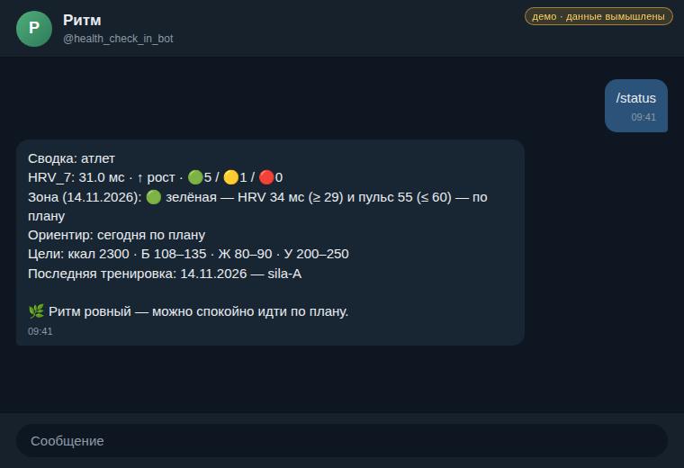
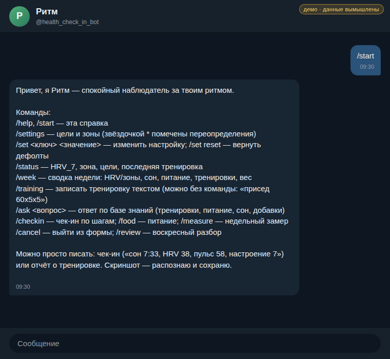
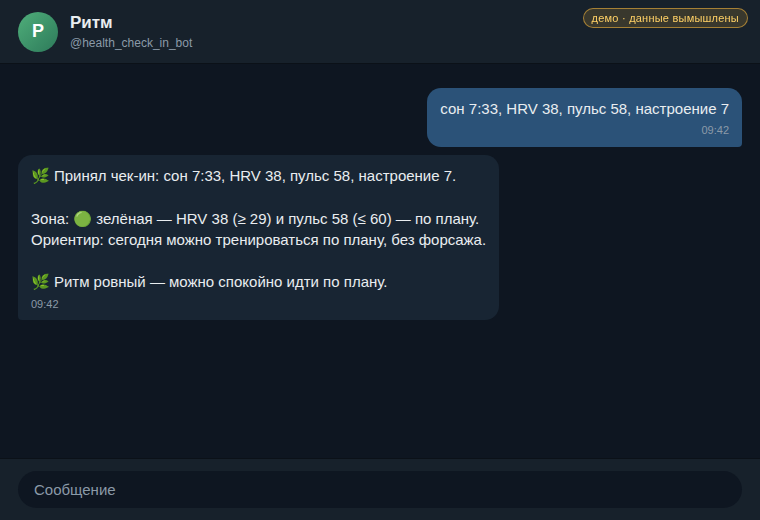
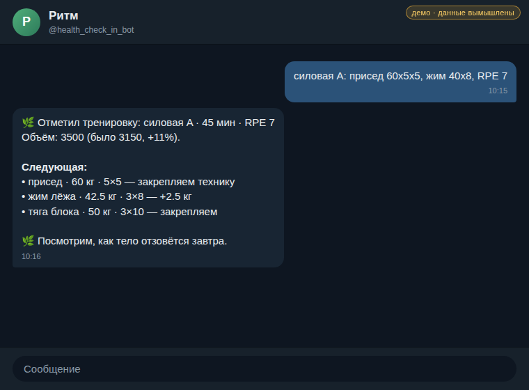
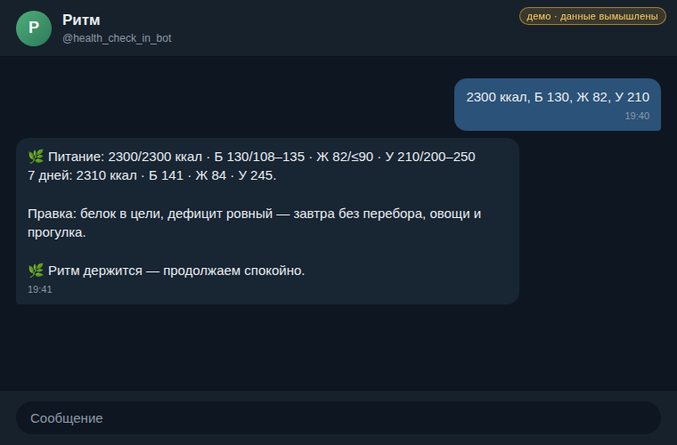
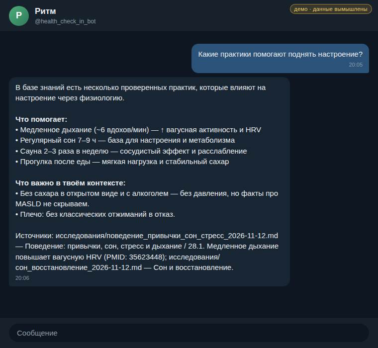
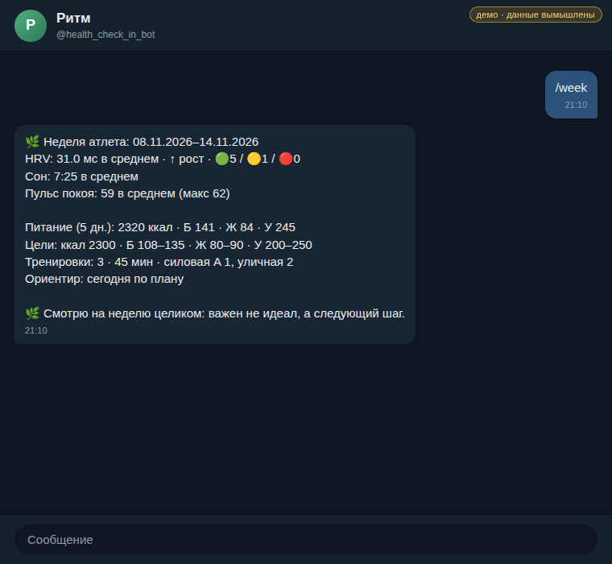

# Демо: как бот выглядит в Telegram

Все изображения — **синтетические демонстрационные скриншоты**. Данные,
имя пользователя и цифры вымышлены; это не выгрузка из реального аккаунта.
Скриншоты показывают актуальный формат ответов: Telegram HTML, списки,
эмодзи-индикаторы, тон «Ритма», источники из базы знаний.

| Экран | Что показывает |
|---|---|
|  | `/status`: HRV_7, зона, цели, последняя тренировка и короткая фраза от себя |
|  | `/start` / `/help`: команды и правила общения |
|  | свободный текстовый чек-ин → сохранение, зона и ориентир |
|  | отчёт о тренировке → объём, следующая тренировка с весами |
|  | питание текстом → ккал/Б/Ж/У, 7-дневное среднее, одна правка |
|  | `/ask` → ответ по базе знаний со списками и источниками |
|  | `/week`: HRV, сон, пульс, питание, тренировки, ориентир |

## Как это сделано

Это не настоящие сообщения Telegram, а HTML-макеты `docs/demo/html`, снятые
headless Chromium. Так проще обновлять тексты без публикации реальной переписки.

Перегенерация (нужен `google-chrome` или `chromium`):

```bash
./docs/demo/generate-screenshots.sh
```

Скрипт пишет PNG в `docs/demo/assets`.

## Почему симуляция, а не реальный чат

- не публикуем личные данные и chat_id;
- не зависим от конкретного экземпляра бота и токена;
- можно обновлять скриншоты вместе с изменением формата ответов.

Реальный бот работает по тем же сценариям; тексты в макетах соответствуют
текущим шаблонам команд и коуча.
